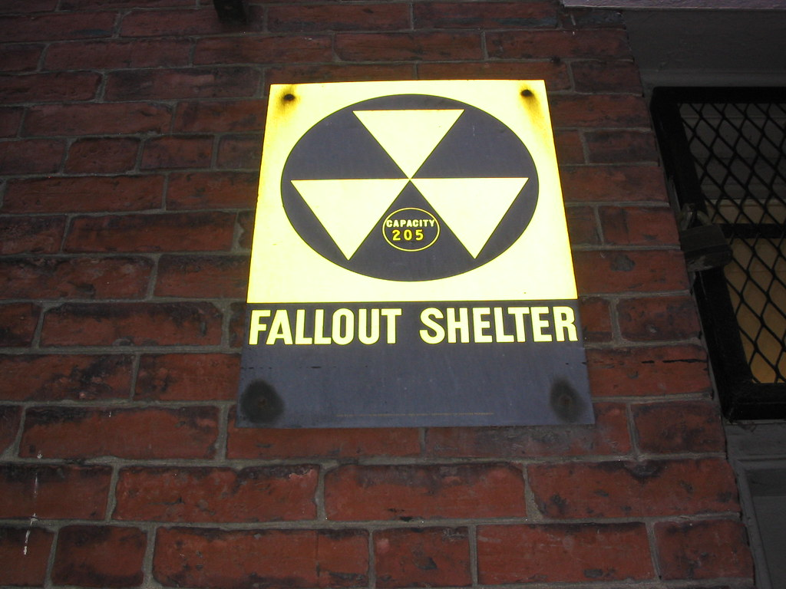

 This map lists publicly marked Fallout Shelters in Boston. During the Cold War, Fallout Shelters were built to house citizens in the event of nuclear war. They are usually pretty easy to spot, though sometimes they can be hidden pretty far off a main road. Clicking on marker in the map should bring up a little more information about it (capacity, etc) along with a link to a longer description and some pictures.

Who knows, there is probably a Fallout Shelter right around the corner from you.

### Know of a fallout shelter I’m missing?

Leave me a comment about it below. I’m lazy and can’t go poking into every dirty alley I find. Let me know and I’ll definitely give you credit. If you’ve got pictures and geocoding, let me know.

If you want to go searching, the shelters seem to be in older brick commercial buildings. A lot of buildings have been refaced in recent years and I think that many of the signs have been lost because of it.

If you see a sign, please take only pictures. The Cold War may be over, but I still don’t think you’d want the possibility of a pair of large men in dark suits knocking on your door some cold night.

### Why map Fallout Shelters?

Call me crazy, but I find the whole mystique—yes, I think there is a mystique—of fallout shelters and civil defense humorously tragic. While today’s geo-political stability is threatened by relatively isolated incidents of aggression, little more than a decade ago the worry was of complete and utter destruction of Earth as we know it.

To protect against this the United States government spent great deals of time, manpower and money. While probably not as much as was spent on missiles, tanks or combat boots, it still represents a substantial effort that went into planning and creating the Civil Defense infrastructure that fallout shelters would be just one part of.

The ludicrousness sets in when you think, _Wait a minute, I didn’t know about any of this!_ In order to avoid scaring everyday people like you and I, _The Government!_ (e.g. your school board and sanitation commission) decided to just not tell anyone about it. Talk about paternalism; it’s like hiding the fire extinguisher because you don’t want people to worry about starting a fire.

Now that it’s all over with, I’m really curious about the whole Fallout Shelter thing. Where the heck are they? What was the total capacity versus population? They are in private buildings. Was the basement rented to the government? Did you get a tax break if you hosted a fallout shelter. Are they still a designated ‘safety area’ or such? Does the city even know where they all are? Why the heck not?

Not to get too off tangent, but I think it’s a little like all those civil war battlefields down in Virginia where you walk around and find rifle casings in the fields. Even though the Cold War was fought elsewhere there are still vestiges of it all around us that we don’t even know about.

### About me

No, I’m not crazy or trying to sell you gas masks, radiation pills or authentic WWII German helmets. This is a community mapping project I am doing for fun and as a test bed for a class I’m teaching on community and memory mapping at LTC in Lowell, MA.

Any information contained herein is researched by myself and very poorly. Sources include:

- Fallout 1 & 2 (the computer game)
- Quantum Leap : The episode where Sam leaps into the brother of a fallout shelter builder who almost shoots his neighbor and then becomes a swimming pool contractor.
- Alas Babylon
- Nearly anything by Robert Heinlein
