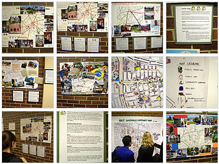

This evening I headed up to the Somerville Central Public Library and checked out the opening exposition of the Somerville Mapping Project, on display through the end of December. It was awesome.

All kinds of individuals, young and old, mapped out on poster board some things that they identified with, liked, disliked, or perhaps just wanted to share with others. There were old photos from the Blizzard of '79 and of mom-and-pop stores driven out of business by regional retailers; news articles and notes. These were connected with colorful string or pipe cleaners to their geographical locations on base maps of Somerville.

In addition to these individual projects, everyone collaborated together on one large map, maybe 7 feet square, and mapped out everything from mailboxes, to empty lots and favorite spots in Somerville. There were some really neat cutouts where you could see some locations at different times of the day.

Most exciting of all though was the use of audio recordings. CD players were lent out at the door and you could walk around listening to different people discussing their maps and their community. Little pictures of headphones and number on maps alerted you to set that track on the CD player to listen to an audio accompaniment.

There was a great turnout of community members and some delicious food at the exposition. I was greatly impressed as well with the level of inclusiveness: all of map explanations were translated in English, Spanish and Portuguese. A Spanish translator was in attendance as well and wove in and out of the speeches and recruitment calls made by the organizers at SNC (Somerville Community Corporation) and ESNC (East Somerville Neighbors for Change)

I am glad I went and found a lot of great ideas for the community mapping project I'm organizing in Lowell.
