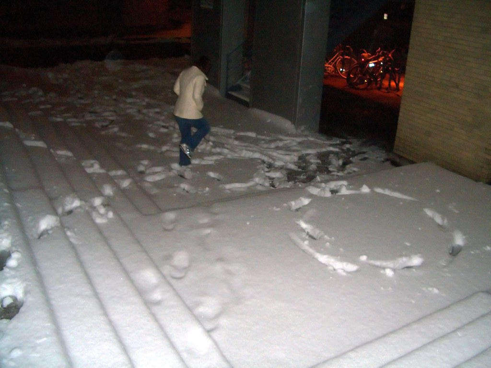

Jess and I were up at MIT to see a friend and coworker in a MIT Community Players production of Autobahn, a series of 7 one-act plays taking place in the front seat of an automobile, by Neil Labute. She was great, the plays themselves were ok and a little redundant by the end.

Leaving the building we had to tread through some relatively thick snow. We tried to follow the footprints of others, though as the photo shows, some of them were a little less than efficient at getting anywhere.
