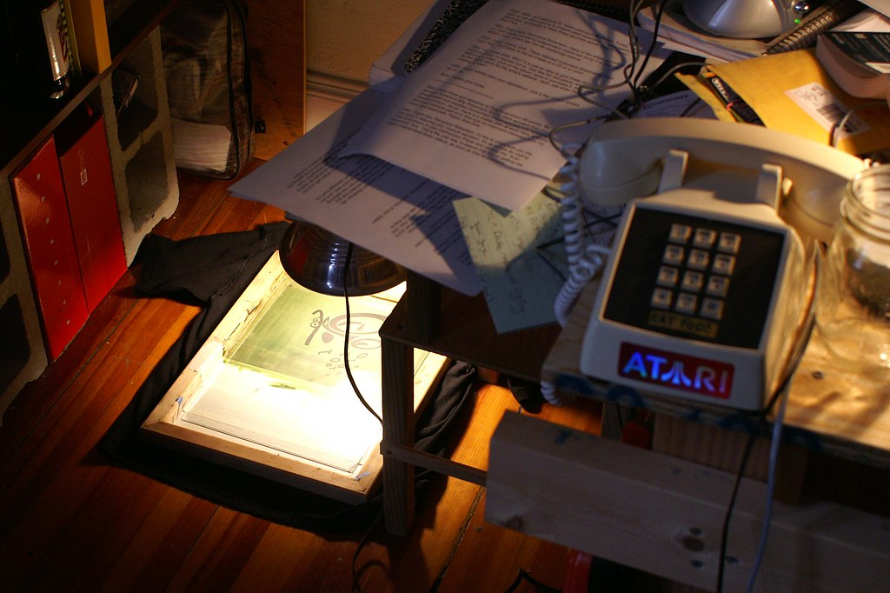

I was over at my pal Dean’s place in Jamaica Plain today. In addition to lots of semi-expired foodstuffs he snags from behind the Co-Op next door, he also has the screens and materials for t-shirt printing. Previously I had been helping him up in Lowell filming some promos for his [Democracy Player](https://web.archive.org/web/20060321152358/http://www.getdemocracy.com/) channel, “Telemusicvision”:http://telemusicvision.com; today we were putting stuff on t-shirts.

The design I decided to print was one of the doodles I had done a week or so ago for the [DigitalBicycle Project](https://web.archive.org/web/20030214001714/http://digitalbicycle.org:80/) while waiting for Jessica to get done with her homework .

The process basically was:

1. Clean off a screen, which is a fine mesh in a wooden frame

2. Mix together the emulsion, which is a bunch of thick green stuff, with a little bit of yellow photo sensitive hardener. Apparently on their own they like to stain, and together they really like to stain.

3. Scrape this emulsion concoction on the screen very thinly, but enough to fill in the mesh. Let dry a few hours in Dean’s oven—it wasn’t turned on, just a good out of the way place.

4. Print the design out onto a transparency. It has to be monotone-mesh doesn’t do gradients. I tried to get to those little halftone circles like Lichtenstein, but Adobe Illustrator was having none of it-I had designed the thing in [Inkscape](https://web.archive.org/web/20060812120129/http://www.inkscape.org:80/), my preferred drawing program and was working off a PNG.

5. Get the (now) dried emulsion convered screen. It is photosensitive—not sensitive like photographic paper, but just don’t point a spotlight at it.

6. Lay it down on something black, in our case a t-shirt—this keeps reflections from hitting the underside; place the transparency on top and then we dropped a piece of glass over that, just to keep it flat.

7. Shine a hundred watt light on it for about 40 minutes.

8. The light hardens the emulsion. So after it’s been hardened, take the screen in the bath and spray warm water on it, which will wash any emulsion from the screen that was covered by the design—since this was blocked by the light and thus not hard.

9. Tape off any non-emulsion filled parts that aren’t part of the design

10. Put on top of t-shirt and now scrape some special black paint over it. Lift off and voila. Our screen wasn’t perfect, so we had to use a q-tip with paint on the end to touch up.

11. Let the paint dry. This being Massachusetts in March, we put it on top of a space heater for an our

12. Lastly, you have to iron the design on the shirt, letting the iron heat each part for about 60 seconds. This somehow “proofs” the paint so that it won’t run in the wash.

13. Rock it.
