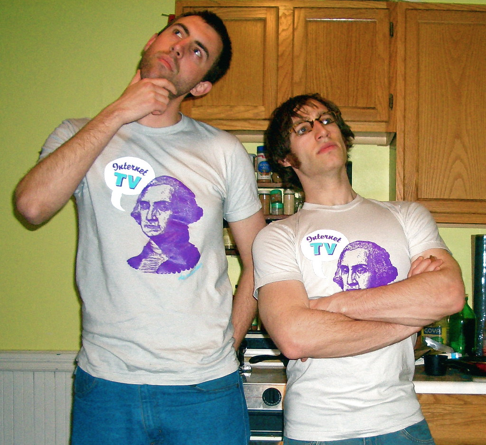

Took this with my bud [Dean Jansen](http://notthemessiah.net). For anyone that says that [community media](https://web.archive.org/web/20070712053537/http://digitalbicycle.org/) and a [participatory culture](https://web.archive.org/web/20080516094553/http://www.getdemocracy.org/) won't have a positive effect on society, at the very least it keeps us well-dressed.
