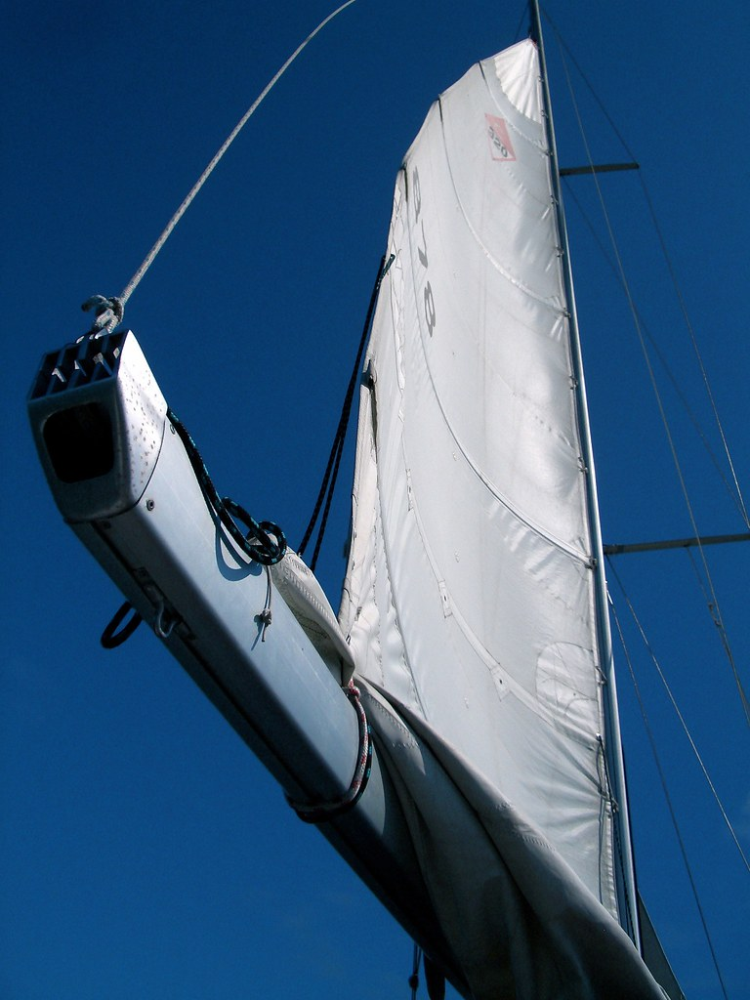
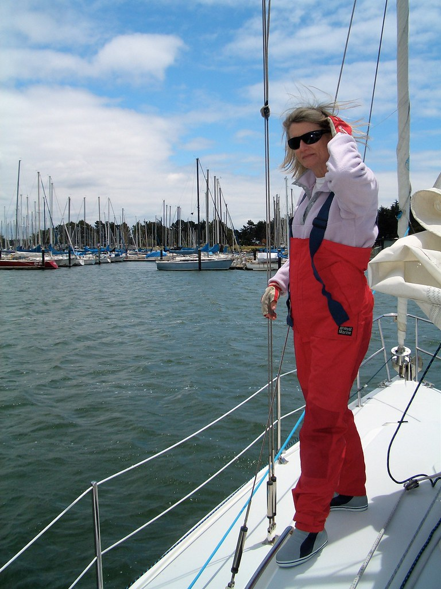
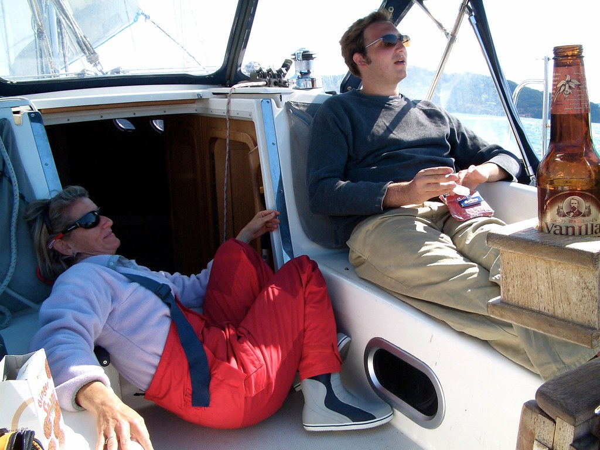
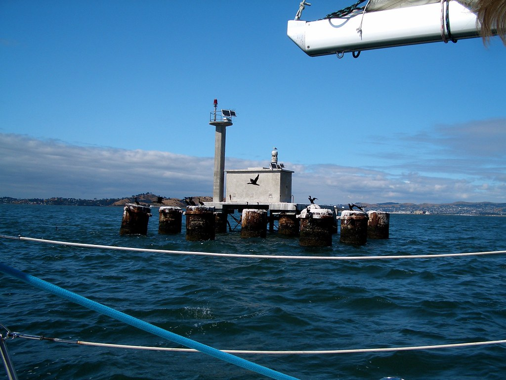
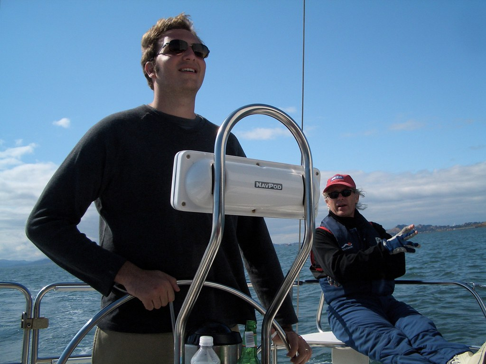
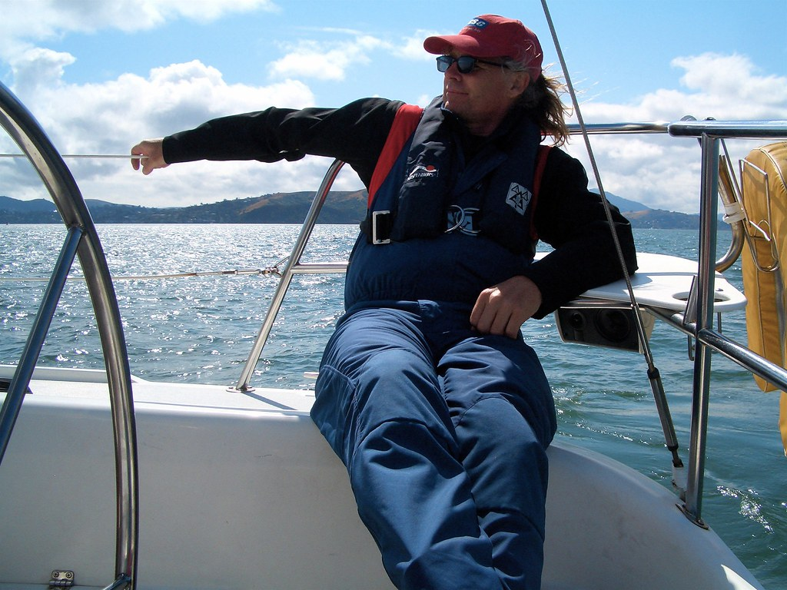

On Tuesday, my last day in San Francisco, Daniell K., the visionary behind the DigitalBicycle, and I took BART up to the Berkeley Marina where we were met by Scott A. and Kari P., community media heavyweights and experienced sailors. The day started off cloudy with threats of rain, but by the time we had gotten through the pre-launch checklist of our -31- +32+ foot Catalina _Magic Moves_ the sun had broken and was shining brightly down upon the bay.

San Francisco's cool, cloudy weather and excellent sailing is made possible by the hot, low-pressure sucking of the Central Valley. On this day, a moderate breeze +(15 - 17 knots)+ pulled our vessel out -past the estuary and through strong tides of the shipping channel- +of the Olympic Circle by Berkeley and into the Central Bay+. We -heaved to- +hove-to+ -about a mile upwind of the channel- +in the lee of Angel Island+, ate lunch, and comfortably drifted down towards Southampton Shoal. Once an elegant [Victorian house](http://www.uscg.mil/hq/g-cp/history/WEBLIGHTHOUSES/southamptonshoals.JPG), the pilings now carry a horn, some navigational equipment, a few solar panels and maybe a dozen terns. Lunch finished, we unlocked the wheel -and jibed away, the wind pushing us back toward Berkeley- +and reached back toward Berkeley+.

+(Thanks Scott for the corrections)+
