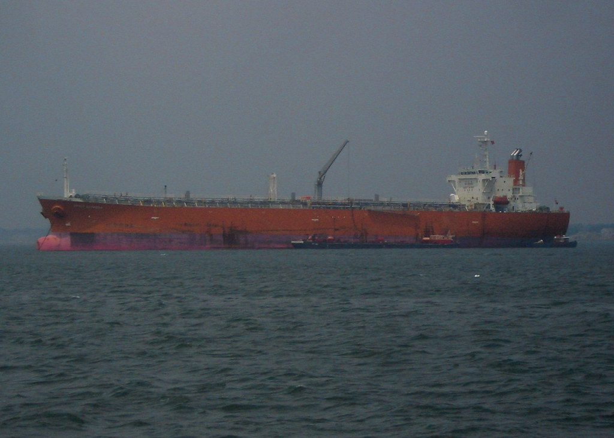

I took a cruise out past the Harbor Islands today. U.Mass Boston runs a ship every Tuesday that's free for students and staff, $5 for everyone else except VISTAs, who with proper haggling, can ride for free.

Today was overcast but everyone was in good spirits. So though we had only mediocre views of the islands, the Captain was very forthright with information about them. Two islands I found particularly interesting:

**Long Island**: Missile silos were placed here during the Cold War to _protect_ the Eastern seaboard. The missiles have long since been removed and the silos left empty, except for one. Today, a missile silo on Long Island is filled with thousands upon thousands of school textbooks. What they're for, the Captain didn't say.

**Gallops Island**: Named for Harbor Pilot John Gallop, this island was farmed for much of the 18th and 19th century. When family and friends came to visit from off-island, they would bring with them rabbits for the children. These rabbits, doing what rabbits do, multiplied, and today the island is overrun by longtails. I suspect that they rabbits were actually brought to be eaten rather than as gifts but perhaps the Captain was giving us the G-rated tour.

The photo above is Boston Harbor's outer berth just south of Deer Island. Ships will offload a portion of their cargo here for a shallower draft. This enables the ship to enter Boston Harbor at anytime, as opposed to waiting until high tide.

For tourist info on the Boston Harbor Islands visit the [Visitor's Guide](https://web.archive.org/web/20060712152158/http://www.bostonislands.org:80/) and for more nutty info read [this article](https://www.bizjournals.com/boston/stories/2002/07/01/focus2.html).
