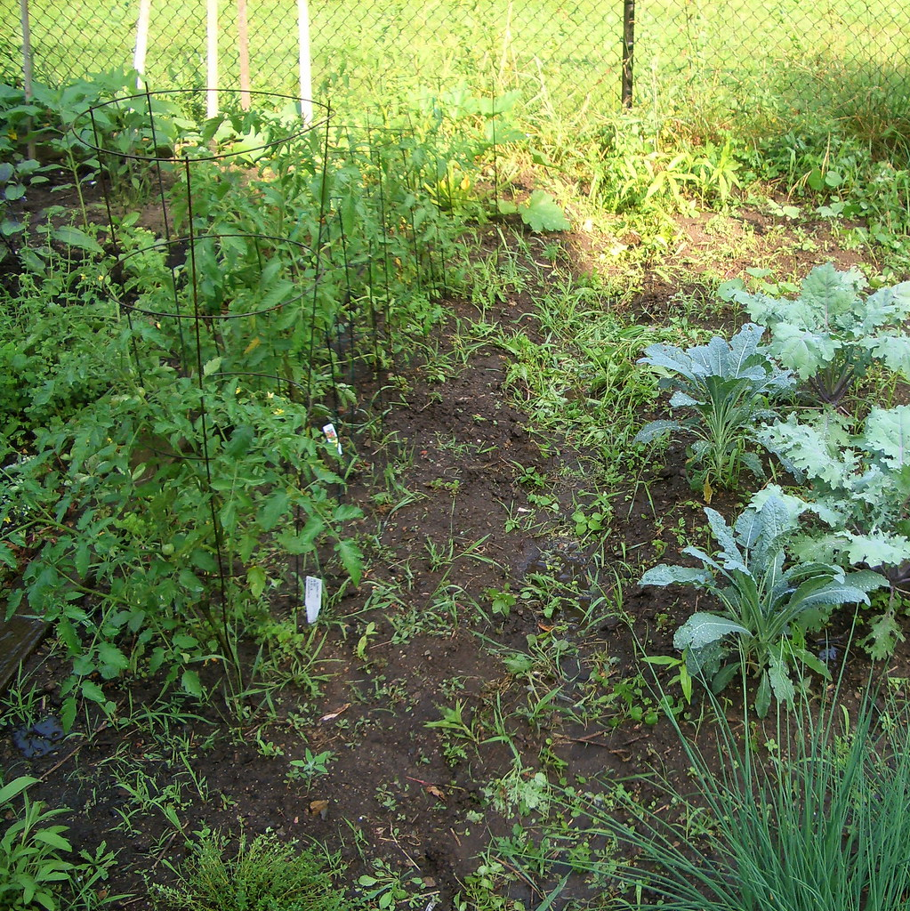
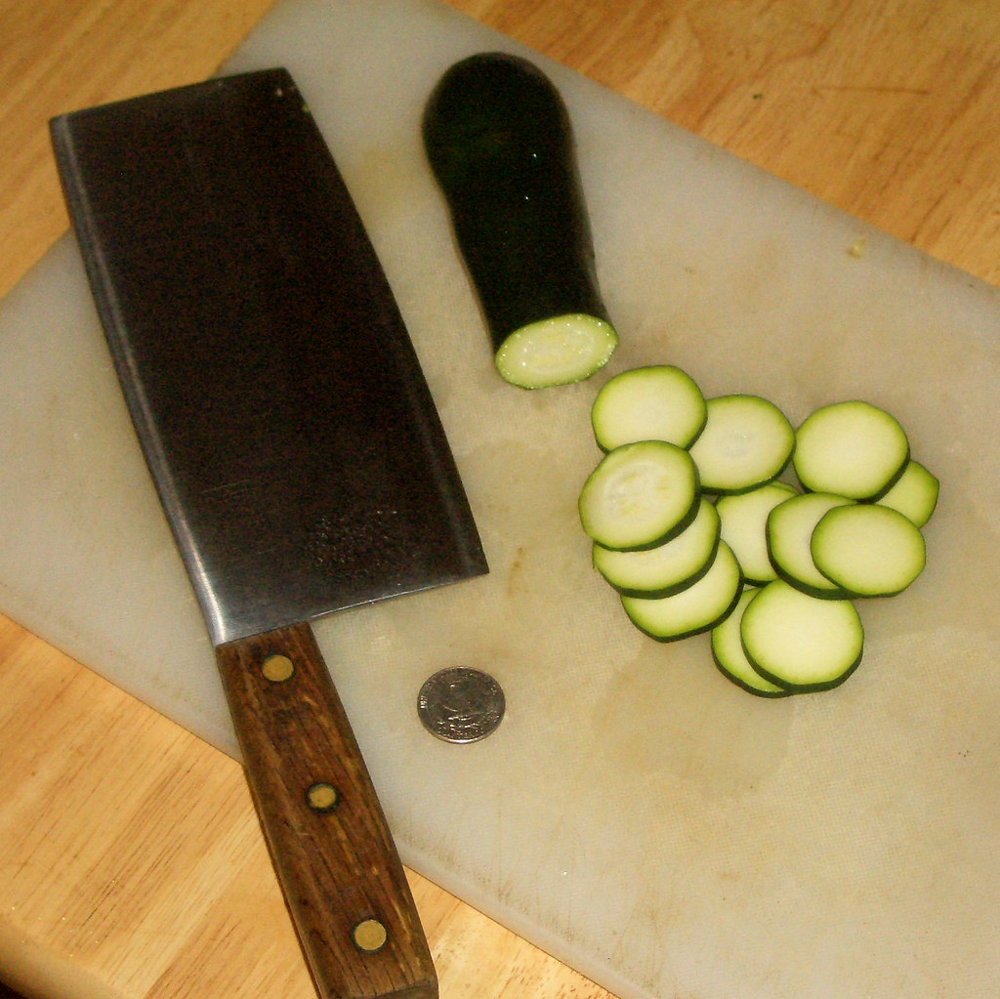
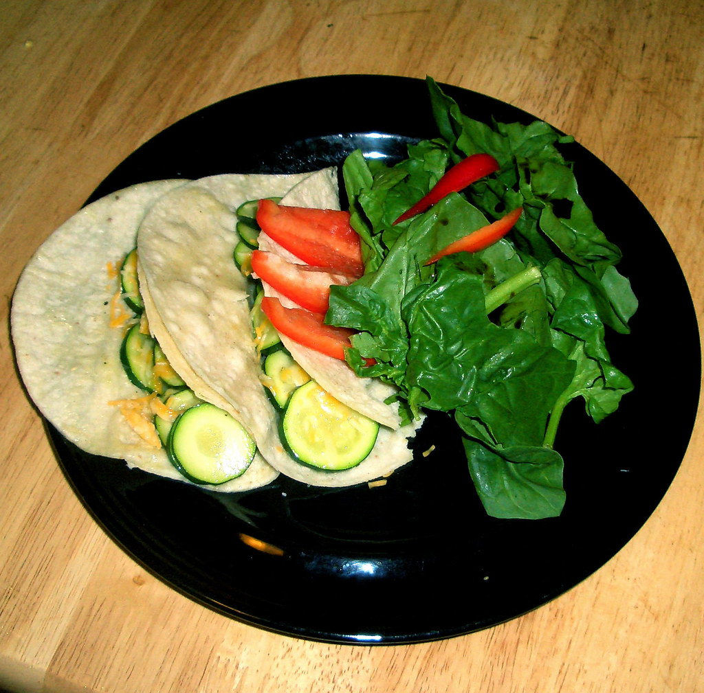

I got my first harvest from the community garden today. Truthfully I've been eating cherry tomatoes off the vine for the past two weeks but this zuchini was my first take-home meal.

  

Only half the zuchini ever made it into a hot saucepan with a little extra virgin olive oil; I just kept munching away raw it was so good. Sliced moderately thin, the zuchini quickly seared and I threw some corn tortillas on top to soften. Then, before the zuchini lost its crunch, I dropped it out onto the tortillas with a bit of kosher salt and just a hint of black pepper. A touch of cheddar cheese on top and a balsamic-spinach salad with some fresh sliced red pepper made it a meal.

Delicious.
