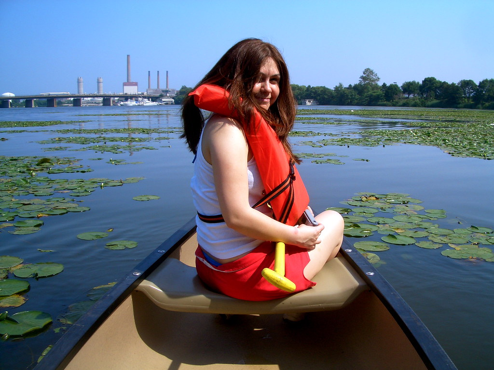
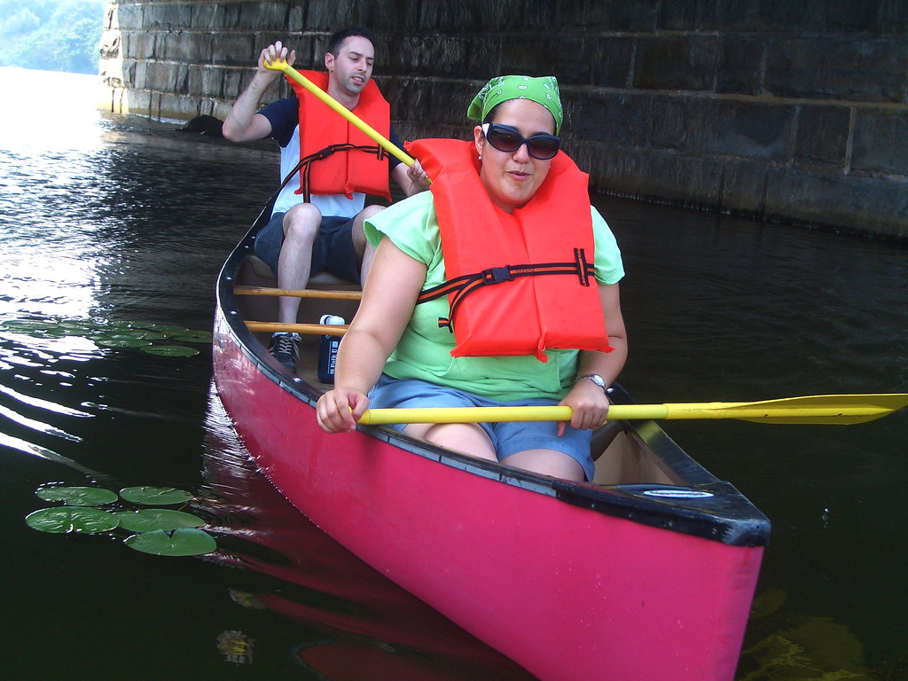

Today was a beautiful, bright and sunny Sunday and my friends Dandy, Danielle, Saul and I headed down to the Mystic River for some canoeing. It was great fun; we only ran into overhanging branches, rocks, bridges, the banks and each other a couple times.

The Mystic River not only has a movie named after it, but comes from the Native American word "Missi-Tuk", which translates to "great tidal river." The river has a long history of pollution from surrounding factories and chemical plants. Two Superfund sites sit within the river's watershed: [Wells G & H](http://www.epa.gov/region01/superfund/sites/wellsgh) and [Industriplex](http://www.epa.gov/region01/superfund/sites/industriplex) .

