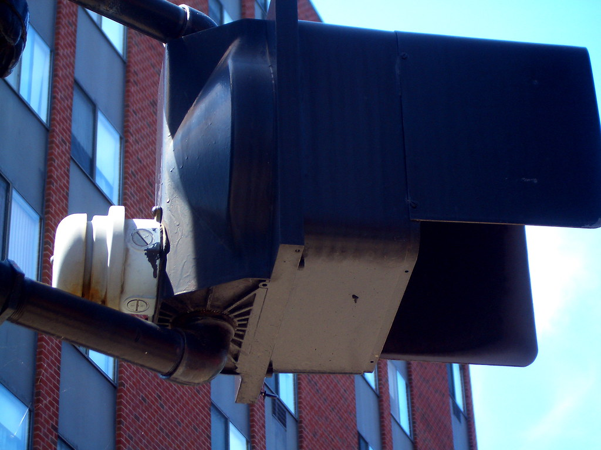
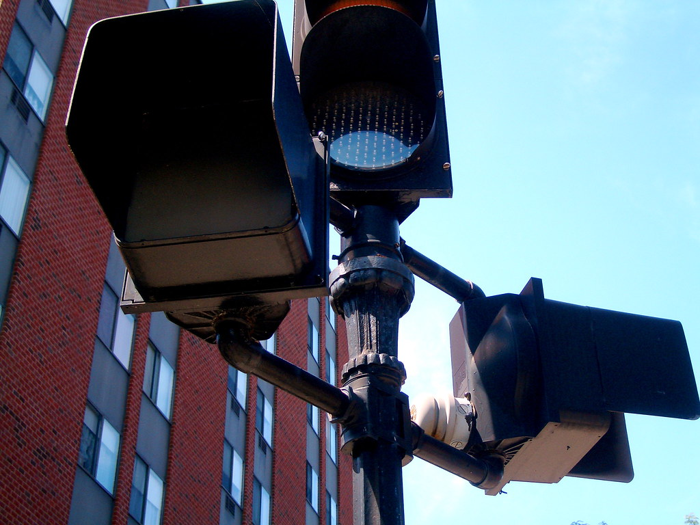

I was out walking in Lowell today; as I crossed the awful intersection of Central, Prescot and Market Streets, I heard a strange ringing, like an old fashioned fire alarm. Looking around, I realized that it was coming from the Walk/Don't Walk sign. This is the first time I've ever heard anything other than the chirp sounds from the pedestrian signals.

 

Of course, Lowell is known for innovation. Agent Orange was invented here. Coincidentally, this also occurred at near the same time as a massive die-off of old-growth trees in the Merrimack Valley. It's amazing the things you learn talking to old people.
