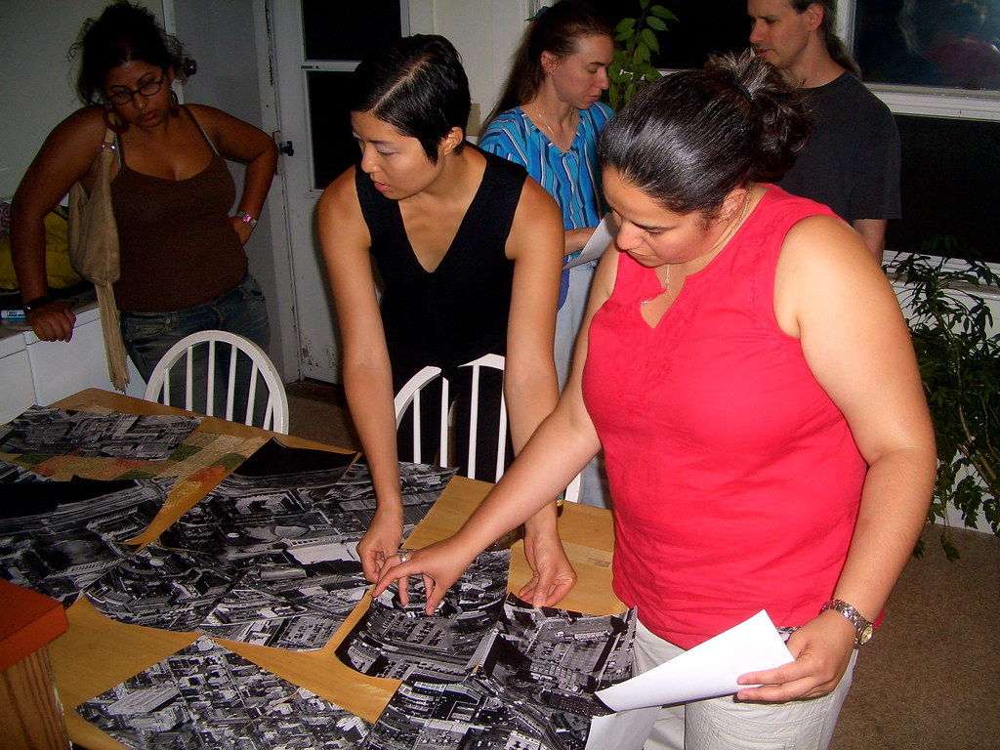

Last night was all barbeque and mapping in Somerville; Adam Holt was host. I met Adam through my Google Map hacking and work with community mapping; I just started joining his monthly meeting of maperati for more remote sensing talk than you can shake a RC30 at.

The evening's purpose, besides eating, drinking and socializing, was to assemble a collage of local satellite photography for the upcoming Wikimania conference at Harvard Law School's Berkman Center; attendees will mark-up the map with observations and stories.

Matching all of the photos was a bit of a chore. Earlier in the day Adam had a friend print off about 50 sheets using Microsoft's Live Local. These black and white prints were cut down to about 10"x10" and somewhere in the process got horribly mixed up. All the photos were obliques (thanks Lisa!), and there were a couple different scales and angles that we had to match up as best as possible. I was pretty surprised with my pattern recognition skills; all that time spent pulling aerial photos in my college library really paid off.

We got the pieces together by the end of the night and the resulting scene pretty impressive. I always like the birds-eye view.
