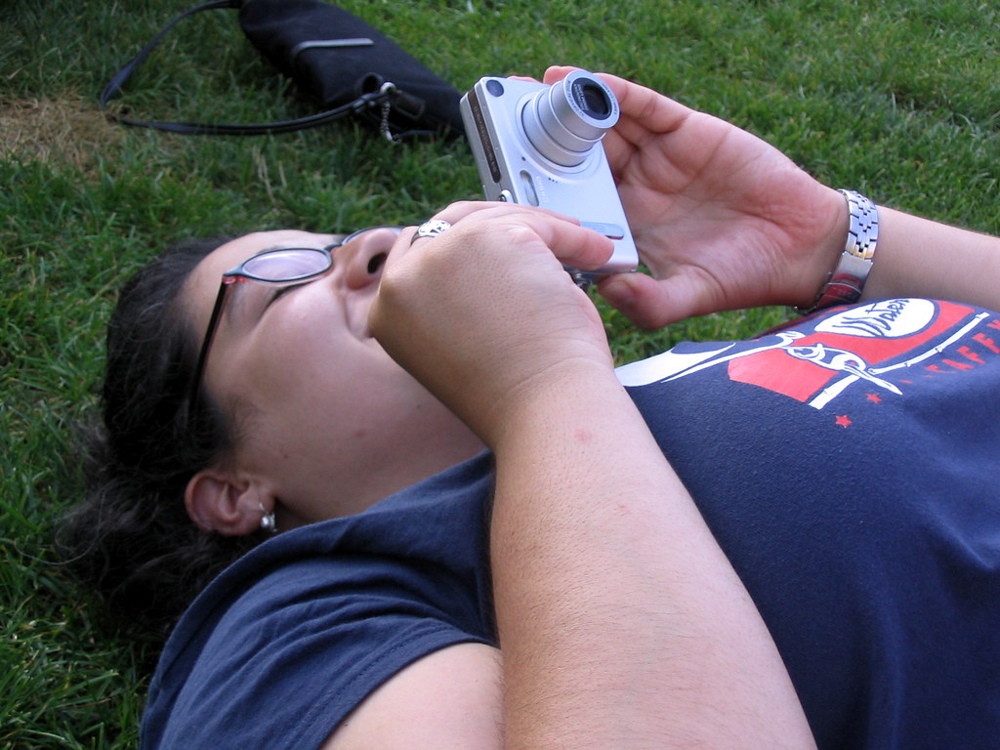
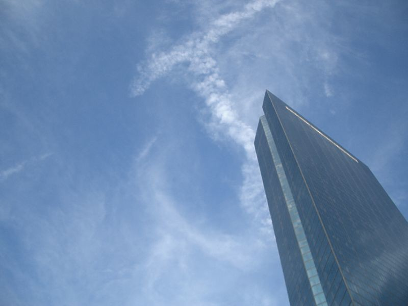
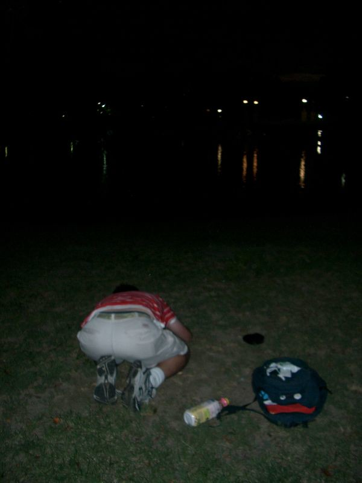
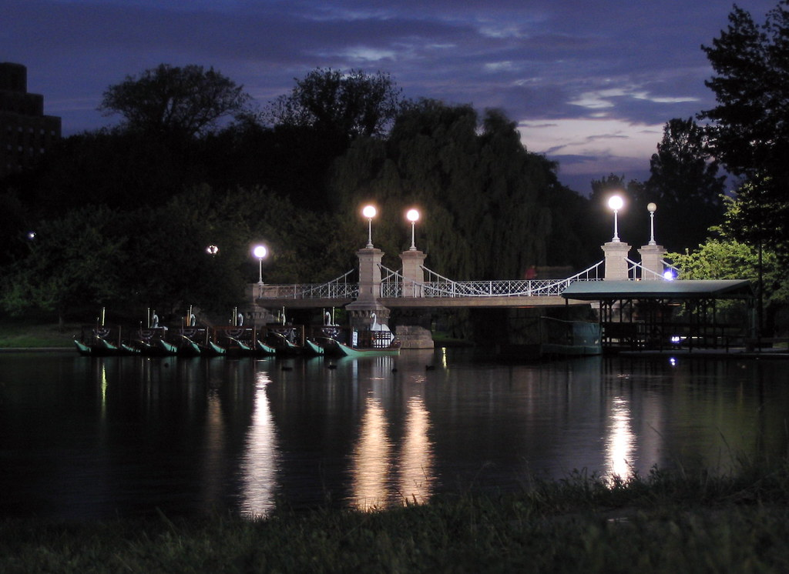

Future fellow VISTA Leader Danielle and I were all about Boston yesterday: Josh Ritter rocked in Copley Square and Wikimania kicked off in Cambridge. Photography loves company and both of us happened to take pictures of each other in the act of aiming; neither of us feel they're very flattering.

 

 
