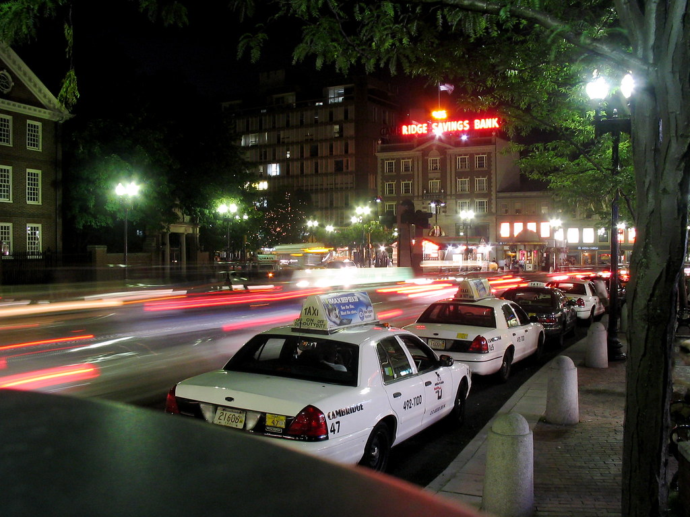
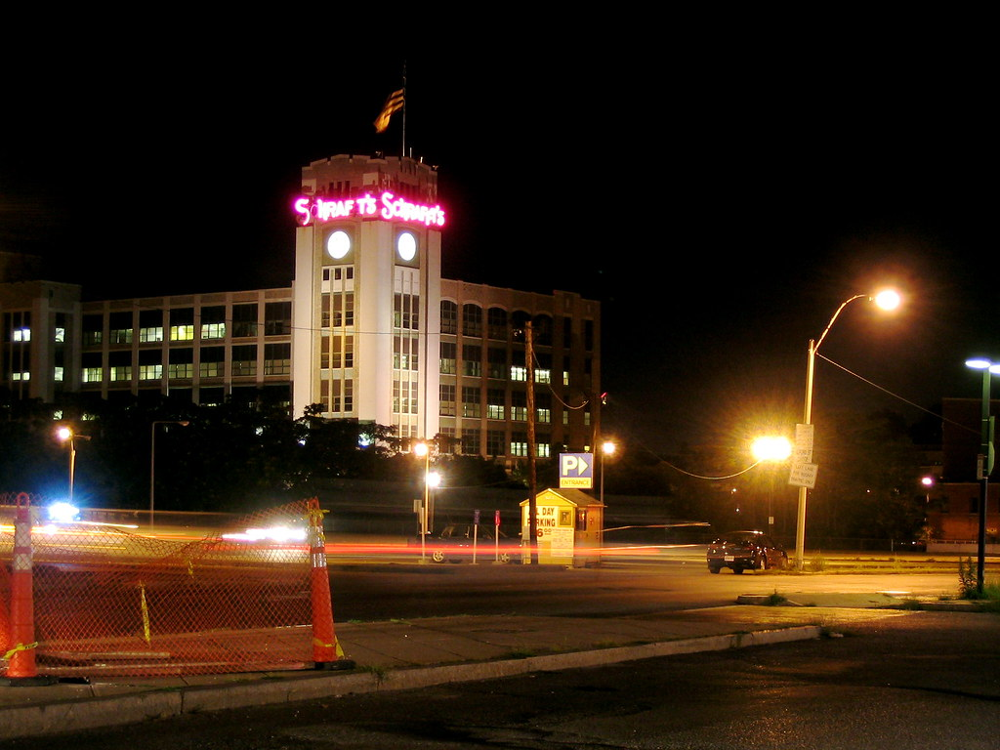

  
My primary digital camera broke about two weeks ago. I pull my old one out of storage; it's clunky as all heck, but the old camera has a lot more manual settings than my sleek, sexy and recently broken one did. To make lemonade out of a bitter situation, I've been taking a lot of more night scenes and abnormal exposures because, well, I can.
  
