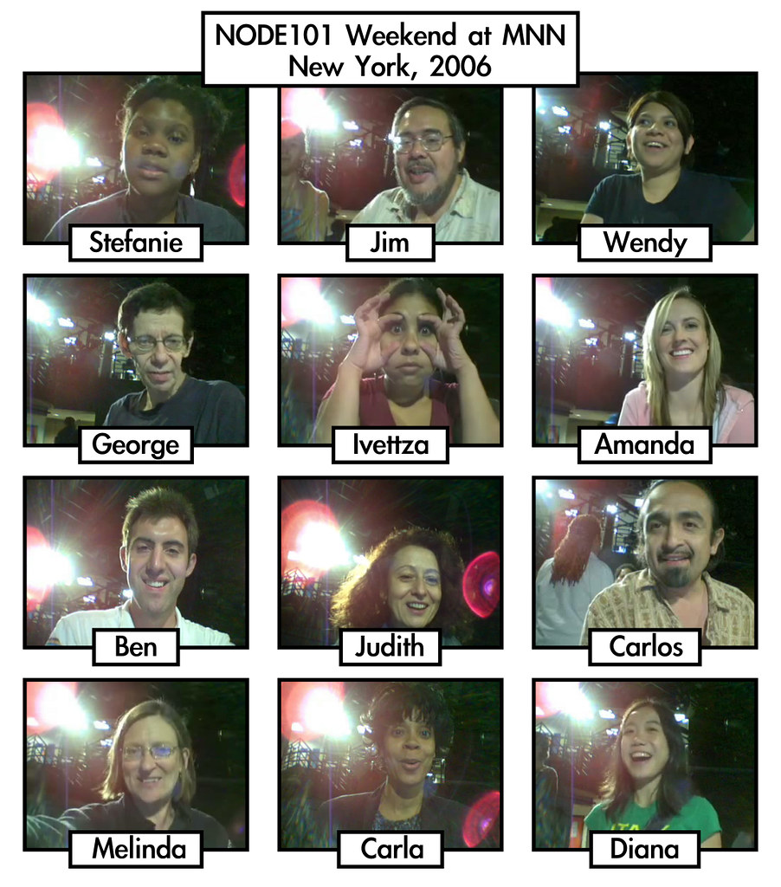

   [video link](https://web.archive.org/web/20070308074255/http://node101mnn.blip.tv:80/) · [fullsize image](https://www.flickr.com/photos/bensheldon/215234231)
I go down to New York City to see my friend's new apartment, and somehow get roped into teaching people how to videoblog. What a crazy weekend. Manhattan Neighborhood Network (MNN) hosted a videoblogging meet-and-greet in their studio on Saturday night as part of [Node101 Weekend](https://web.archive.org/web/20060814210244/http://node101.org:80/). There were lots of food, people and of course cameras. Many attendees were cable access producers who had never vlogged before. I showed them how easy it was to [shoot, edit, compress and upload](https://freevlog.org/). Click on the tableau above, or [here](https://web.archive.org/web/20070308074255/http://node101mnn.blip.tv:80/) to see what people were posting.
  
