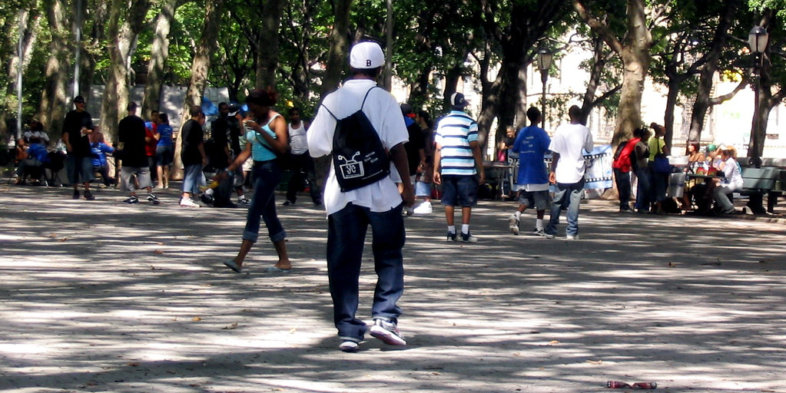
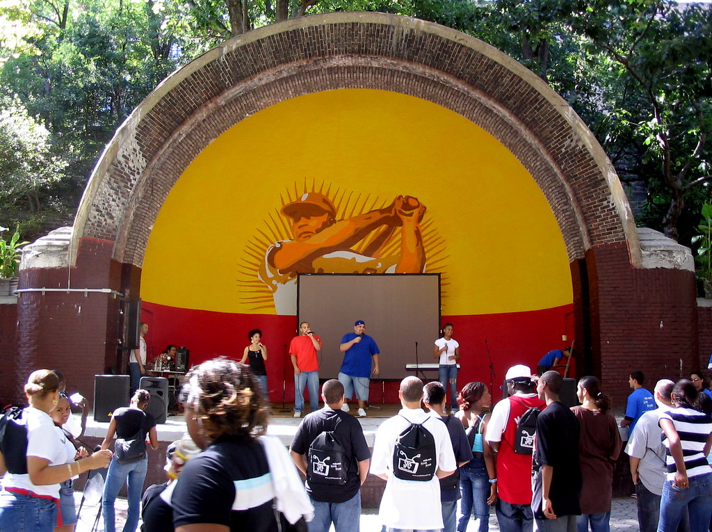
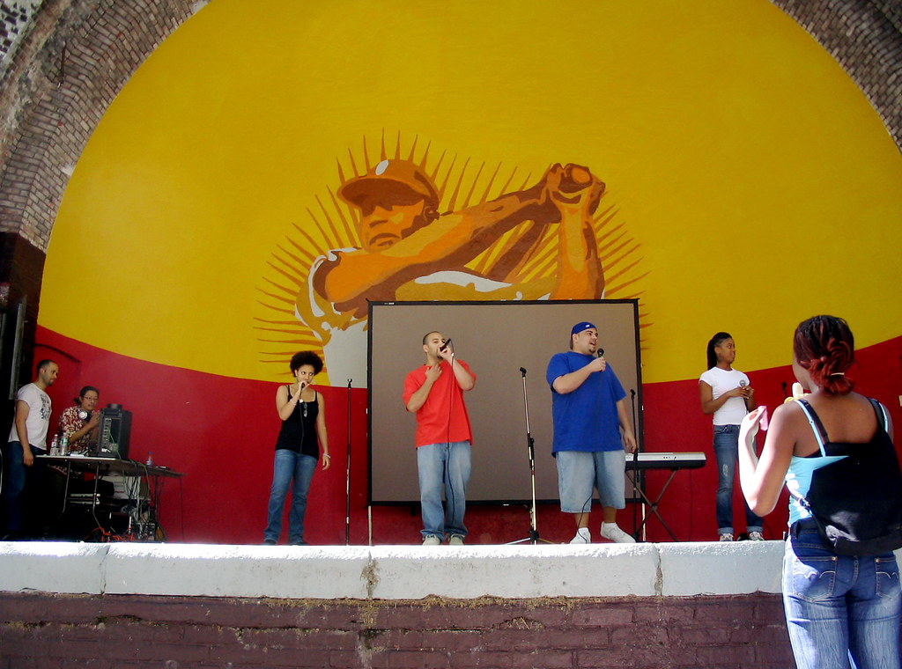
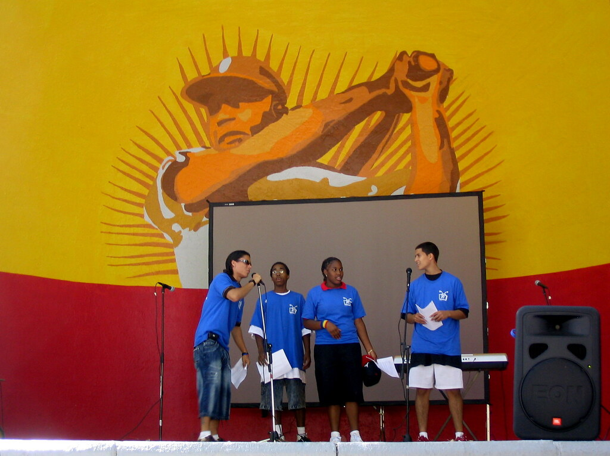
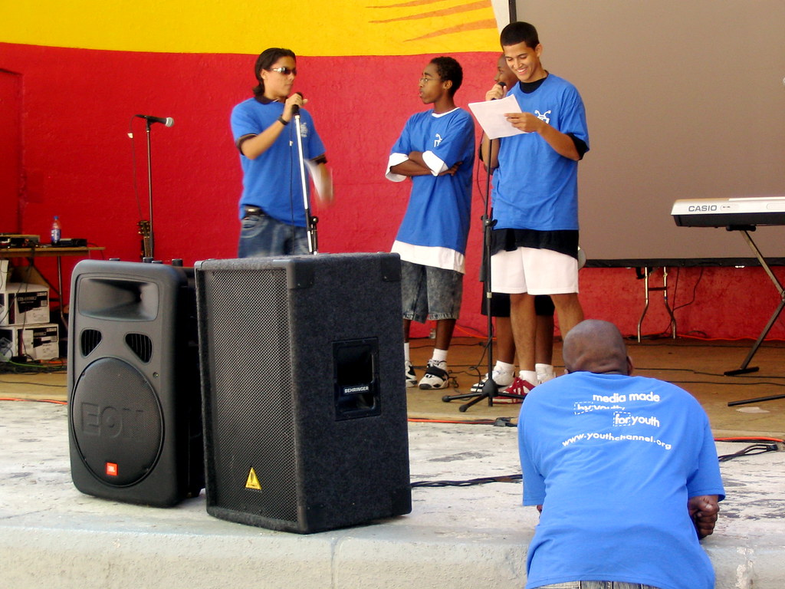

  
After my [long walk](https://island94.org/node/86) on Saturday I ended up in Harlem for a [Youth Channel](http://youthchannel.org) blockparty hosted by [Manhattan Neighborhood Network](http://mnn.org) (MNN), one of the largest (if not _the_ largest) public access stations in the country. Youth Channel provides disadvantaged, low-income and minority youth with access to a quality media forum through which to express creativity, foster dialogue, and to encourage social and political participation. At the blockparty there were lots of food, music, fun and of course, cameras.
     
