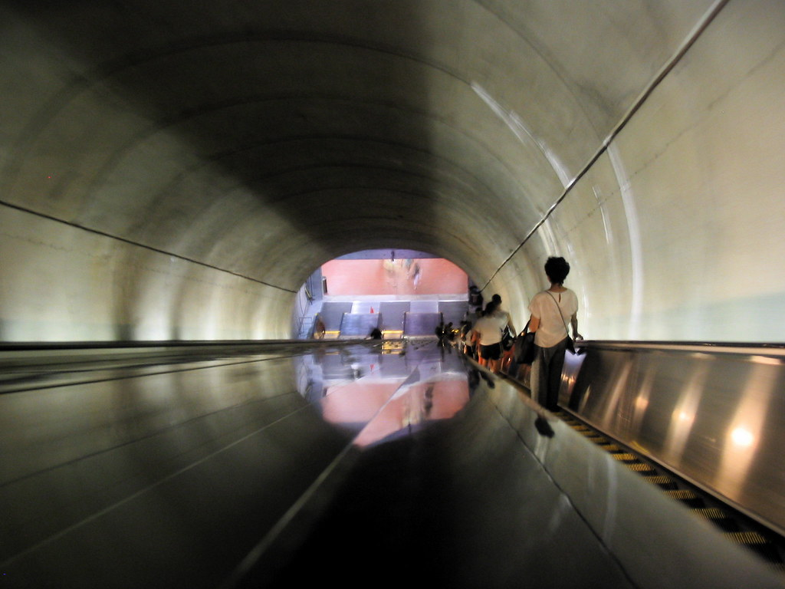

  
The first apartment I looked at when I moved to Boston was near Porter Square in Cambridge. I remember thinking that the escalator coming out of the bowels of the Porter T-station was the longest one I had ever ridden; I've believed that up until my most recent trip to Washington, DC. The escalator at the Woodley Park-Zoo Metro-station is definitely longer. I was a little farther than halfway down by the time I pulled out my camera and snapped this picture.
