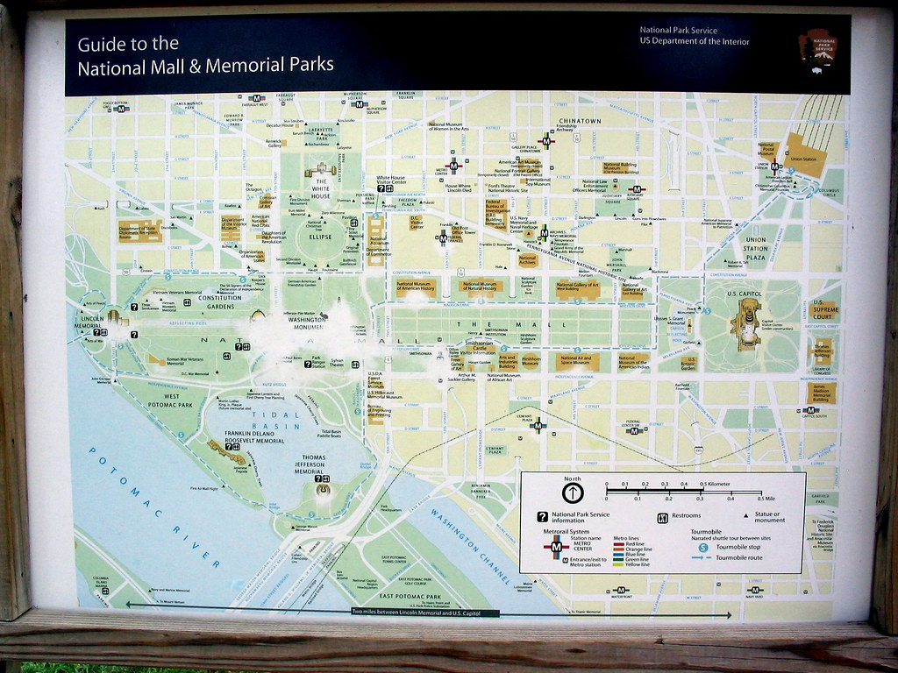

  
  [Online community maps](https://web.archive.org/web/20070819093518/http://www.mappingaccess.com/ "a directory of Cable Access Television stations") are cool but they aren't the only way that everyday people can interact with cartography; sweaty, dirty, pointing fingers work just as well. I took a photo a while back of a subway map in Boston that had been [similarly affected](http://island94.org/node/9), and here's one for downtown Washington, DC. This was taken on 17th Street between the WWII monument an the Washington Monument.
