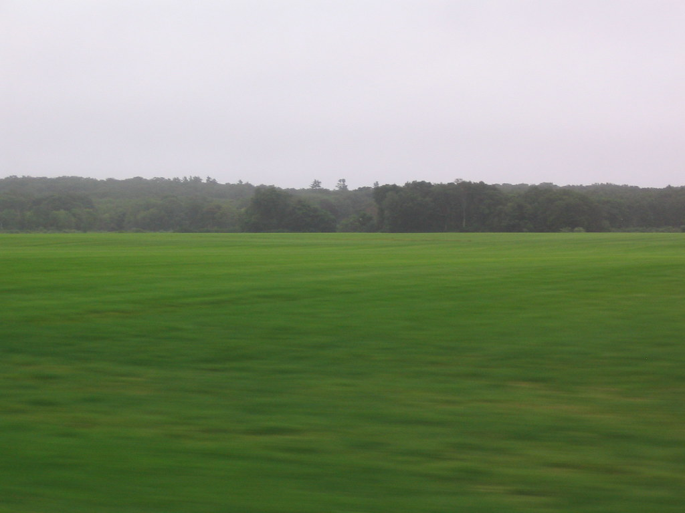
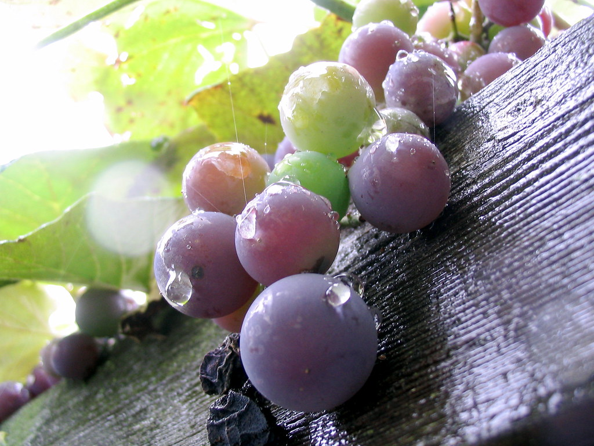
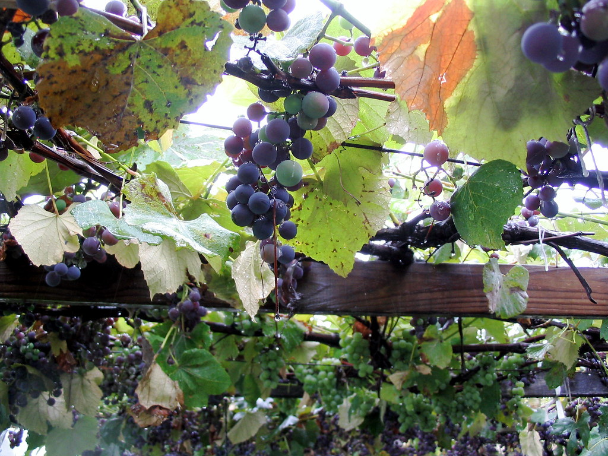
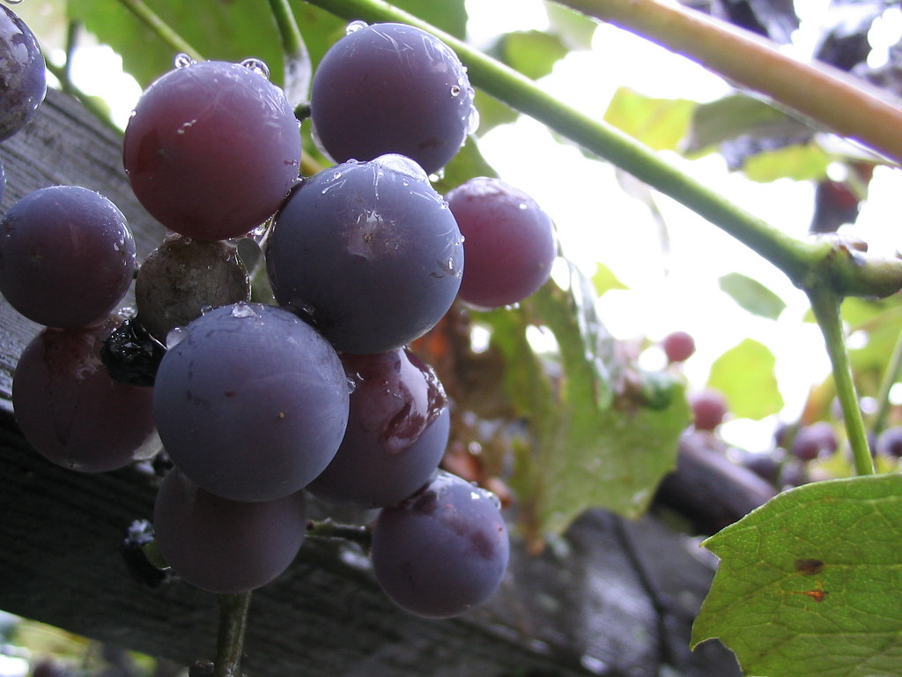

It's a little late to write about, but I spent Labor Day weekend in Rhode Island.

It turns out that Rhode Island is the largest producer of turf grass in the North East: more than 4,000 acres of turf. That's a lot of sod.

It rained all day Sunday, so there was nothing else to do but take pictures of delicious wine grapes and eat them too.

 
