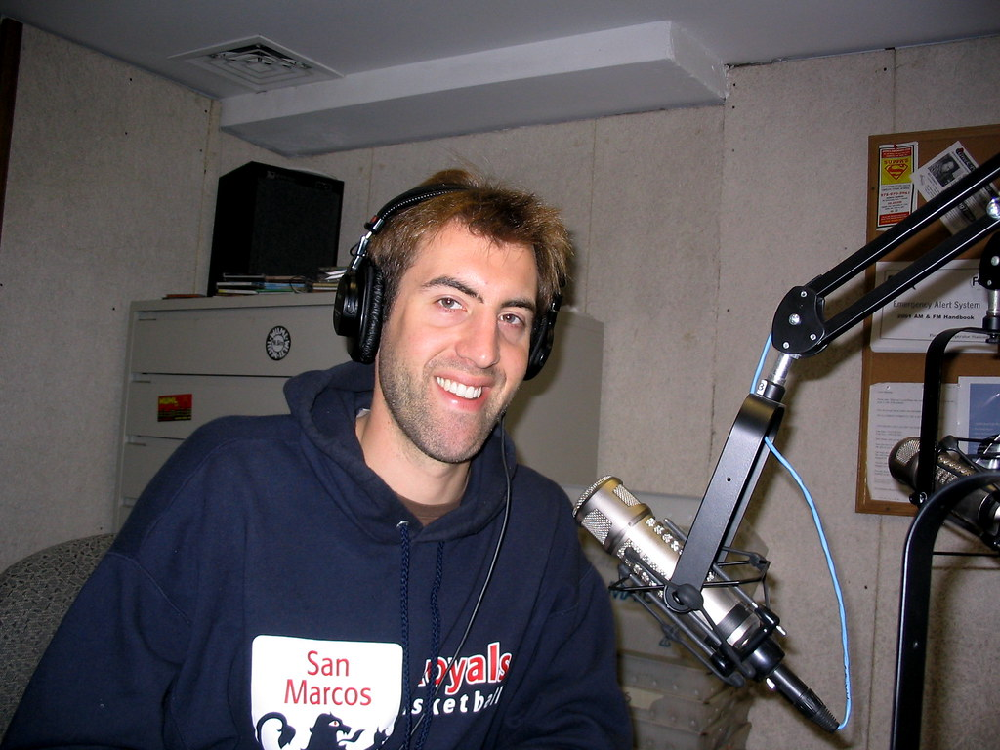
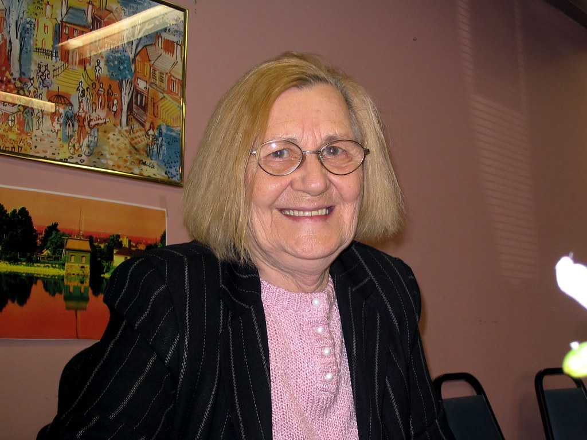
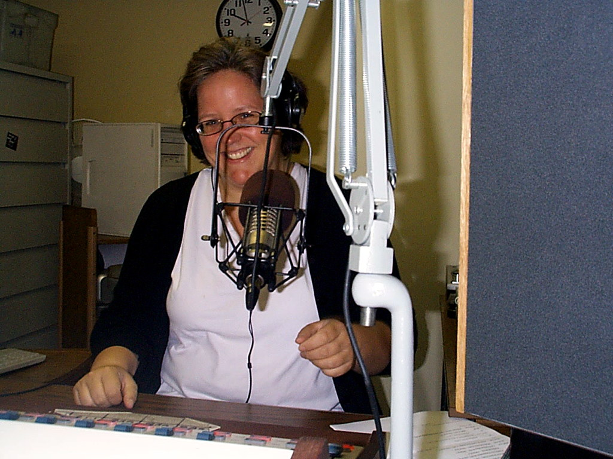
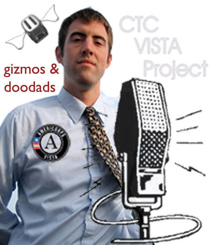

  
I was lucky enough to be invited on _Talking Out Loud_ this morning with wonderful hosts Felicia Sullivan and Charlotte Crockford. The live show was aired on UMass Lowell's radio station, WUML. I mostly discussed AmeriCorps\*VISTA and the CTC VISTA Project and had a blast.
[Click here to listen to interview!](http://island94.org/files/Bens-Interview-on-WUML_20060922.mp3)
Fellow VISTA Leader Danielle was awesome to make this recording for me. We made one from the soundboard, but our recording device accidently had its internal mic on as well, so there was lots of extraneous noise; though Danielle's was made by putting a microphone up to the computer speakers. Danielle also made me the picture below.

