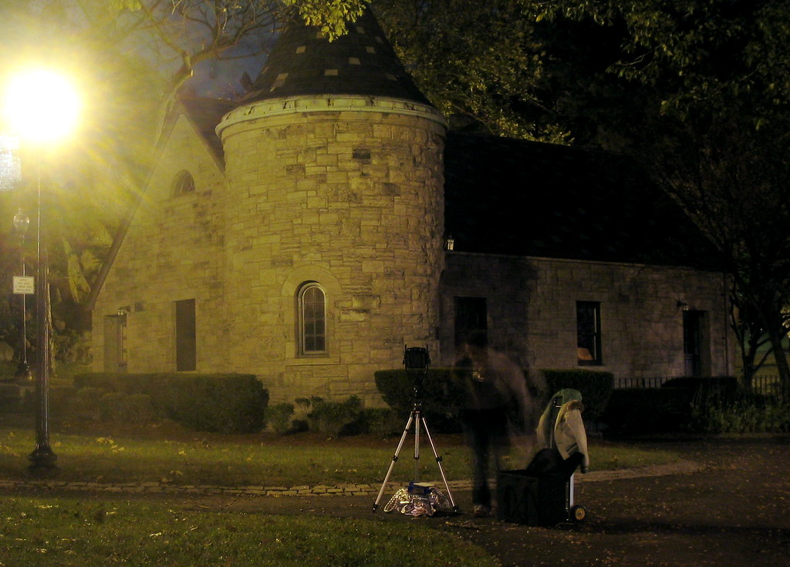
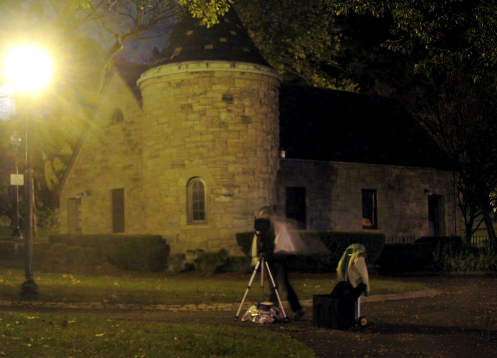

   
I was passing through Somerville last night and in Powderhouse Square I ran across photographer-stranger Tia taking some large format photos. Powder House Square was the focal point of 1774's Powder Alarm during which British Soldiers took possession of potential militia firearms and supplies. The subsequent mobilization of militia forces "essentially provided a 'dress rehearsal' for the Battle of Lexington and Concord seven months later." ( [Wikipedia: Powder Alarm](http://en.wikipedia.org/wiki/Powder_Alarm)).
