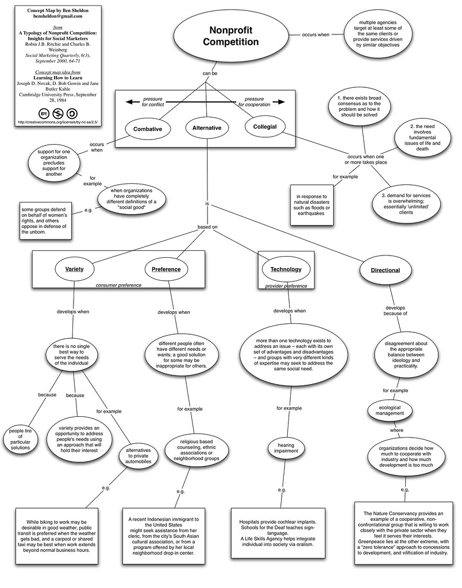

At this summer's CTCnet Conference the thing I most took away--or rather, repeated to the most number of people--was something said by the keynote speaker, Ami Dar, the creator of Idealist.org.

He was asked by someone in the crowd something along the lines of "In what areas do you want to see nonprofits develop into the future?"

Ami Dar responded that an area that he saw as important was **acknowledgement of nonprofit competition**. His brilliant reasoning was this:

> In for-profit companies, everyone accepts that competition takes place; it's a given. Businesses identify the areas in which they compete, and from this, also gain an understanding of the areas in which they _don't_ compete. In the areas in which they don't compete, businesses can cooperate. Nonprofits, in general, are not aware of, or acknowledge that they compete (and they do), and because of this, they cannot collabrate as efficiently or as effectively as possible.

My own example of this is the Detroit automakers. Ford and GM are incredibly competitive in car production, features, pricing, dealerships, etc. But at the same time, they have an incredibly strong combined lobby for setting safety and emission standards, things that affect the entire industry. They know where they compete and therefore know where they can work together.

So this has been rattling around in my head until I read two things:

This first was ["Learning How to Learn" by Joseph D. Novak, D. Bob Gowin, and Jane Butler Kahle](http://www.amazon.com/Learning-How-Learn-Joseph-Novak/dp/0521319269/sr=8-1/qid=1161788036/ref=pd_bbs_1/104-3768589-3995934?ie=UTF8&s=books), which lays out some very interesting models and heuristics for visualizing information.

The second was [A Typology of Nonprofit Competition: Insights for Social Marketers](http://www.sauder.ubc.ca/faculty/research/docs/weinberg/ISM_2000.pdf) by Robin J. Ritchie and Charles B. Weinberg.

Putting them together, I made this using OmniGraffle:

[Download the PDF](/uploads/2006-10/Typology_of_Nonprofit_Competition-concept_map.pdf)

