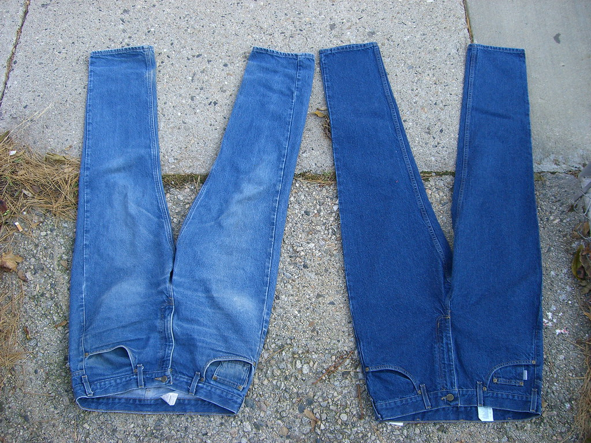
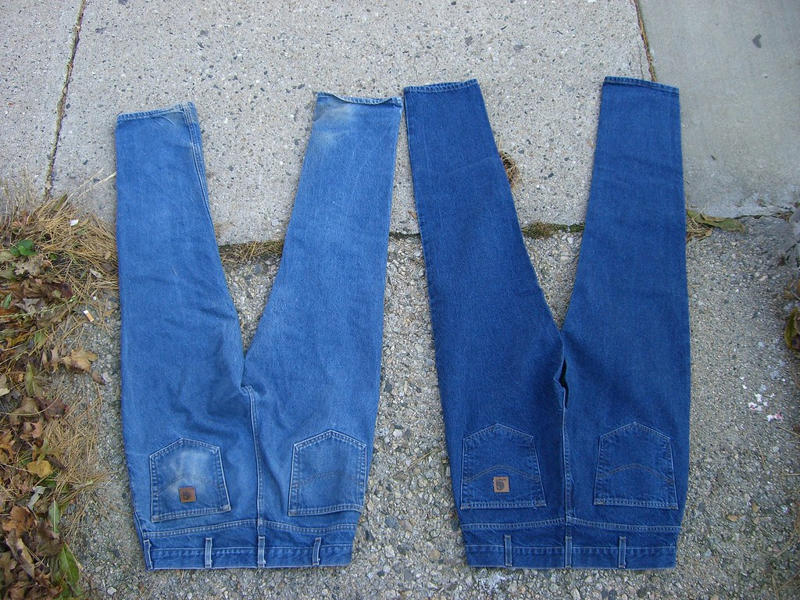
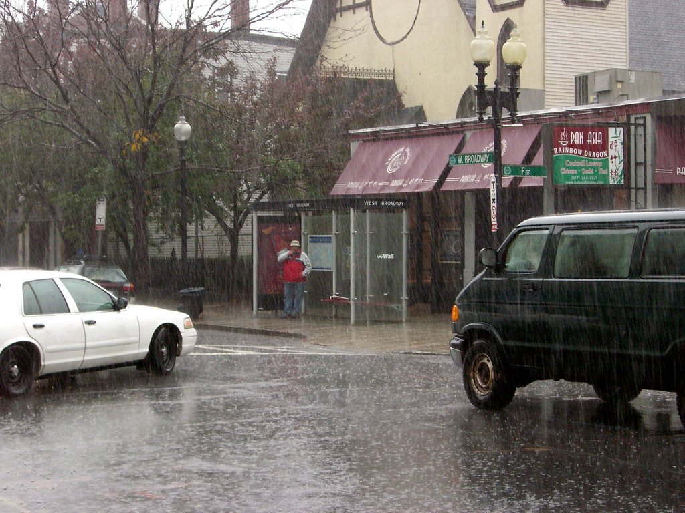
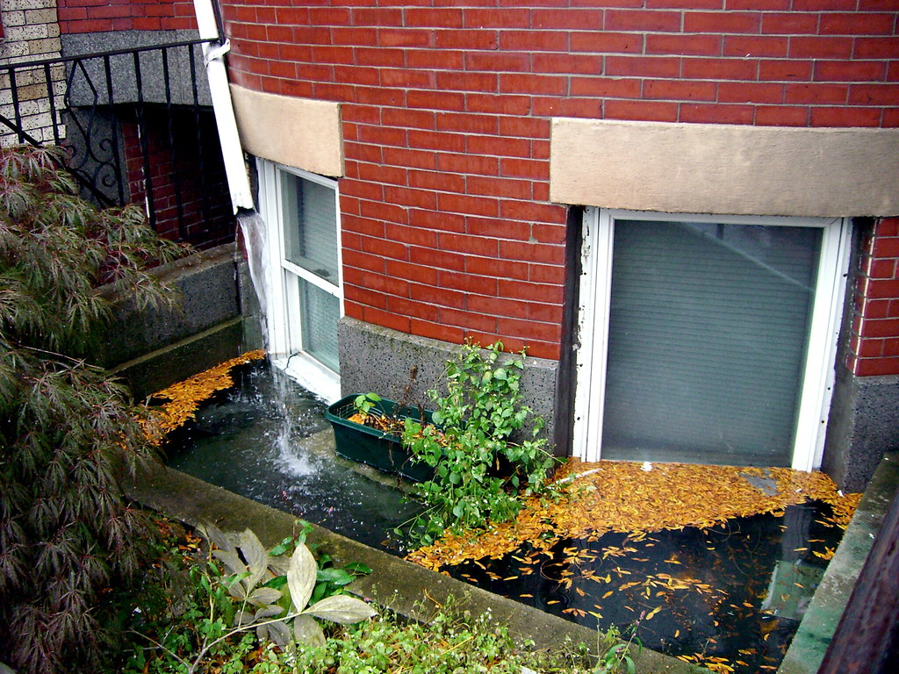

 

_Click on the photos to see explanations of the wear marks_

I purchased a new pair of jeans last weekend. In fact, I got the exact same brand (Carhart), style (relaxed-fit) and size (34-34) from the same store (Jones Department Store, "Jonesy's" in Southie vernacular) at the same time of year (Novembrish) as I did last year. I also bought a new cap too. I don't want it to seem like I don't make progress in my life but the cap is identical too, to one I got last year (it matches my mittens) on the same expedition. Its progenitor was lost to the Boston Public Library one cold March morning.

Buying pants is always exciting for me; I never even owned a pair until I was 13--in San Diego one can get away with that. My mom likes to tell the story of my middle school principal saying to her after eighth grade promotion (for which I was en-panted), "I never thought I'd see the day with Ben in pants."

In side note, it was pouring rain last Saturday when I went out to Southie to buy the jeans. Jonesies is far up on East Broadway; and while I caught the #9 bus there, I walked/swam back.

 
