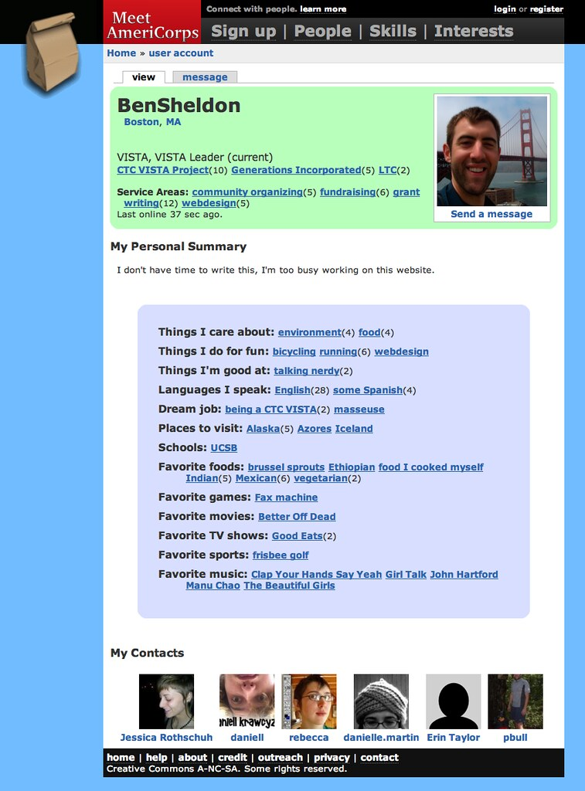
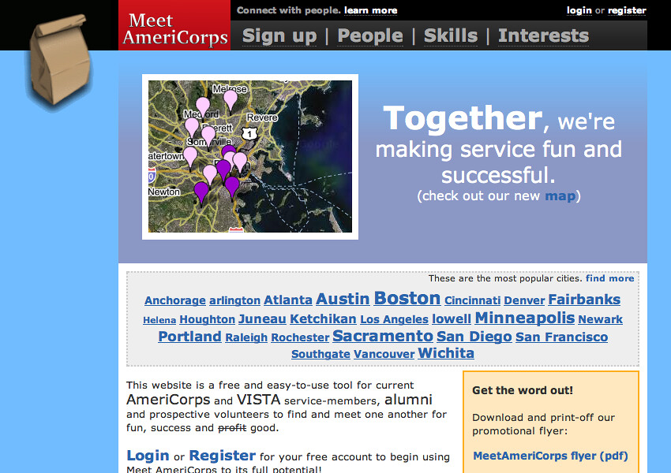
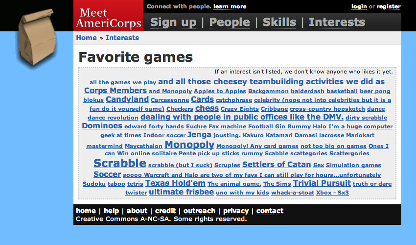
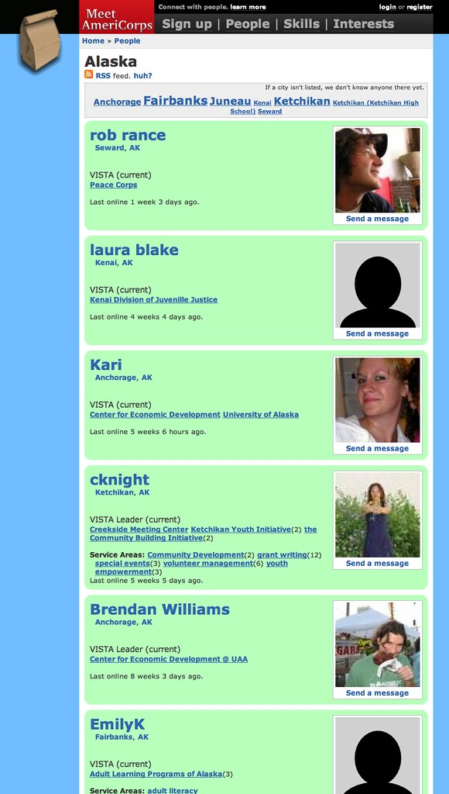

My pet project, [MeetAmeriCorps.com](http://meetamericorps.com) has finally passed that development milestone that marks a "social network": Buddylists. To be a little more haute, we've decided to call them "contact lists", but the concept is the same: you can demarcate people who you like/know/want-to-be-on-your-contact-list.

Since I haven't really been advertising it too heavily, Meet AmeriCorps _was_ a directory--now it's a "social network"--of AmeriCorps and AmeriCorps\*VISTA volunteers who are either currently serving or alumni. It's pretty neat stuff, doesn't look to shabby and, disclosing I am the lead developer on the project, actually kind've useful.

We put together MeetAmeriCorps.com to fill what I see as a sorely lacking need. [AmeriCorps](http://americorps.gov) and VISTA are essentially-governmental, national-service programs that mostly places full-time, stipended volunteers with community organizations. AmeriCorps speaks of itself as a "network" that is creating a "national service movement". Unfortunately, it doesn't have the capacity to truly achieve this because, in my opinion and experience, AmeriCorps and VISTA members generally **do not**:

1. communicate with other members serving with other organizations (even organizations inside a single community)

2. self-identify as AmeriCorps volunteers

3. collaborate on developing resources and capacity

AmeriCorps and VISTA currently provide [some](http://vistaolinc.net) [tools](http://nationalserviceresources.org/resources/listservs/index.php) and [resources](http://nationalserviceresources.org) to achieve #3, but I believe that #3 cannot be achieved with volunteers being able to effectively communicate and identify themselves as AmeriCorps both to each other and the outside world.

Meet AmeriCorps seeks to provide an easy-to-use tool for AmeriCorps members to meaningfully interact with one another both within service, and outside of it. I hope this will improve the experience of being an AmeriCorps or VISTA volunteer and contribute towards creating a true network and movement.

_These screenshots were made with the OSX app [Paparazzi!](http://www.derailer.org/paparazzi/)_
