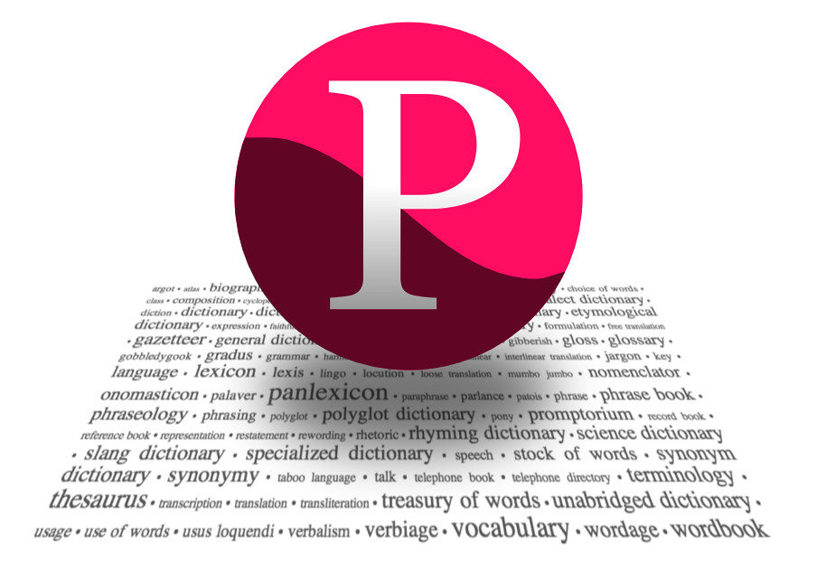

I'm very proud to be officially launching ** [Panlexicon.com](http://panlexicon.com): a unique thesaurus**. Using intuitive **"tag clouds"** to represent synonyms, [Panlexicon](http://panlexicon.com) makes discovering the word you want quick, easy and explorational.

Panlexicon's current functions allow you to:

- **First**, perform a lookup on a single word and receive a weighted cloud of synonyms.

- **Second**, view synonyms that overlap across multiple words either by entering the words manually, or clicking on words already in the cloud to further refine your search.

**For example**, performing a search on " [cool](http://panlexicon.com/?query=cool)" provides a wide variety of synonyms from "chilly", to "unimpassioned", to "groovy". Refining the search using [cool _and_ nifty](http://panlexicon.com/?query=cool,nifty) provides more refined synonyms.

By varying the size of the typeface, like tag clouds do, the most relevant terms **pop out at you** allowing you to quickly scan through large lists of words. Also, because the algorithm is a little fuzzy, you may run across related words that provide better context.

Panlexicon was developed jointly with [Rebecca](http://circuitous.org) who originally proposed the project and did much of the research on thesauri and helped develop the word relevance algorithms.

The word lists come from the [Moby Thesaurus](http://www.gutenberg.org/etext/3202) as part of [Project Gutenburg's](http://www.gutenberg.org/) library of free electronic texts. [Drupal](http://drupal.org) is used as a simple framework for core functions such as database abstraction and page callbacks and to simplify future feature developments. Google AdSense is activated on the site, but that is due more to curiosity over the interplay of contextual advertising and the word lists than on any current revenue model.
