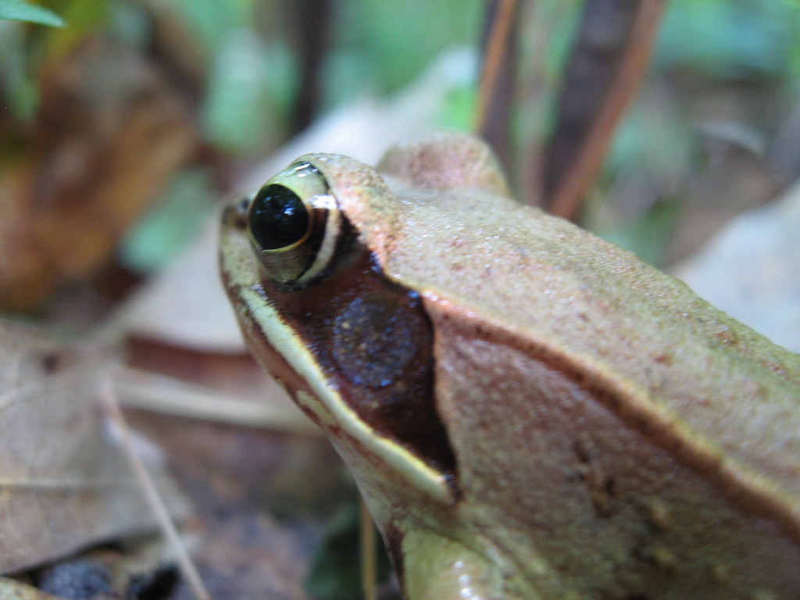
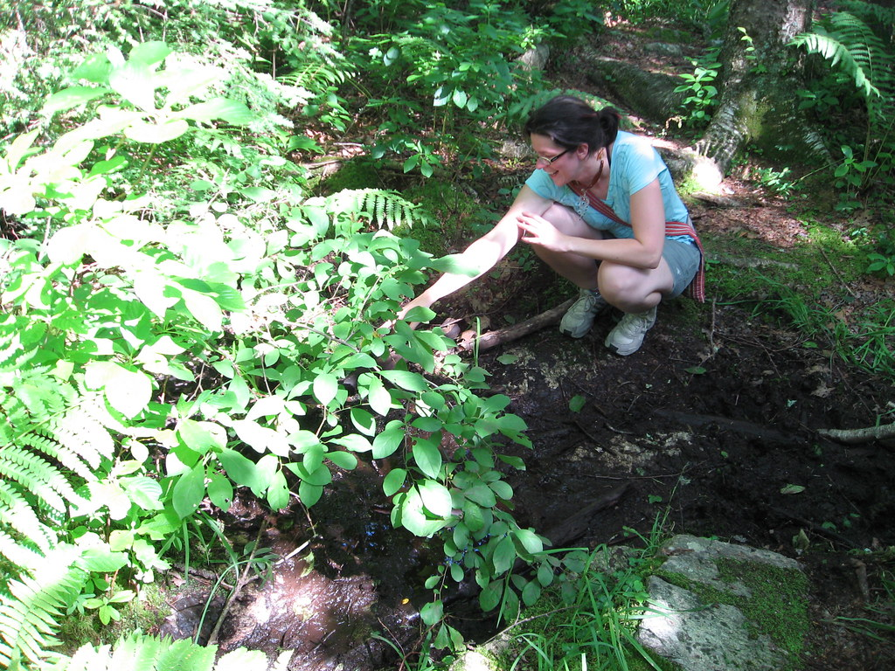

 

A few weeks ago I hiked the [Walkabout Trail](http://www.google.com/maps?q=Providence,+RI,+USA&ie=UTF8&ll=41.92353,-71.75776&spn=0.00372,0.009388&t=h&z=17&om=1) in Northwestern Rhode Island with my friend [Helen](http://flickr.com/photos/helenday/). The trail was gorgeously green and mossy with many fun frogs, toads and critters. We hiked the eight miles (which cuts for shorter walks) in a little over three hours, which was a great pace leading up to a cooling swim in the adjoining pond afterwards.

