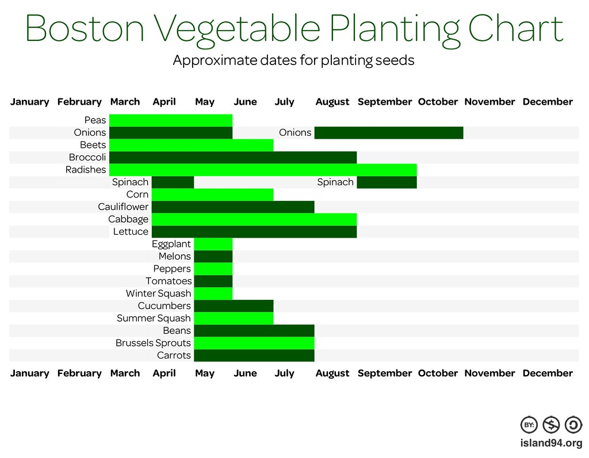

I made a simple chart of approximate seed planting times for Boston (USDA Zone 6). You can [download a printable PDF of the planting chart](http://island94.org/files/island94.org/Boston%20Vegetable%20Planting%20Chart.pdf).

Today I put together a simple raised bed in my backyard. I built it along the same design as the [Food Project's Build-a-Garden Program's planter](http://www.thefoodproject.org/agriculture/Internal1.asp?ID=601)---which my landlord participated in last year. Other than shoveling 1300 pounds of soil needed for an 8 x 4 raised bed, it was pretty easy. The only really novel part is putting a sheet of weed-block between the ground and the planting soil to keep the vegetables from growing down into polluted city-dirt.
