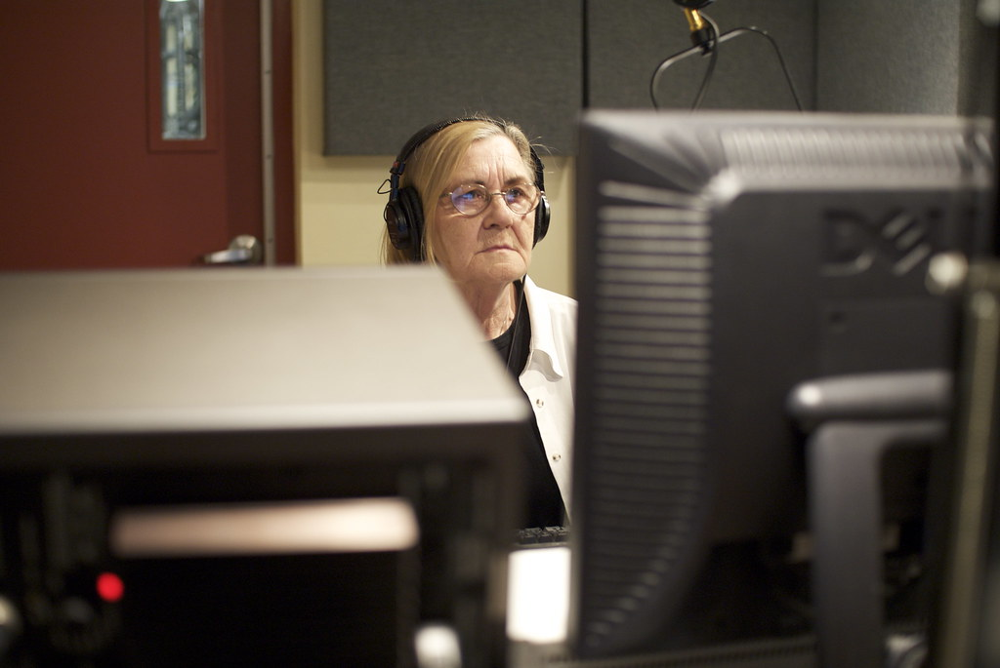
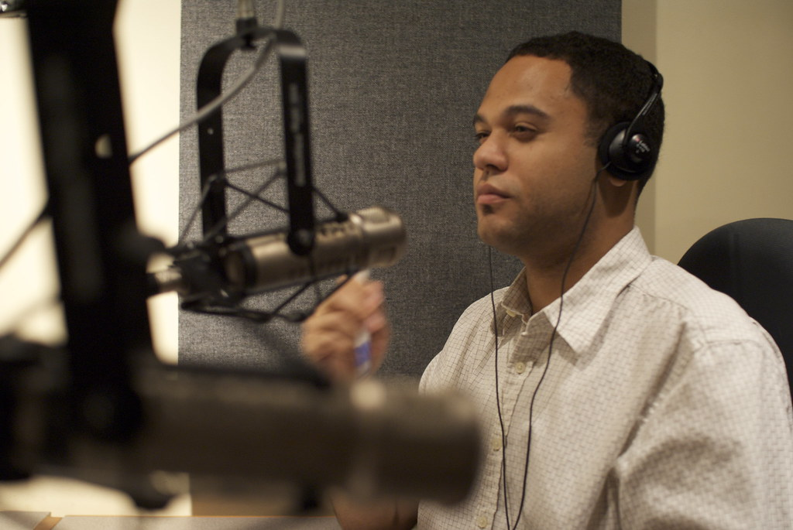

   

I returned to the airwaves this morning with my coworker Jules to talk about nonprofits and society on WUML. My good friend Charlotte, who I know from my Lowell cable access days, hosts [Thinking Out Loud](http://www.uml.edu/thinkoutloud/) every Friday morning. I [previously was a guest](http://island94.org/node/99) on her show two years ago plugging my job, the [CTC VISTA Project](http://ctcvista.org).

This time, Jules and I had a free-ranging discussion on the nonprofit sector and its role in constructing society. As we're arguing, nonprofits are hamstrung as social innovators because of their structure: barred from advocacy, they concentrate on services which---while individually valuable---provide only symptomatic relief rather than comprehensive reform. We don't want to discount the valuable and necessary services of nonprofits (not at all!), but believe that a parallel movement of advocacy and reform is key to building a better society. While nonprofits are perhaps a natural place to begin dialogue, vision and action for improving society as a whole, those components must ultimately move beyond the narrow confines of traditional nonprofit organizations in order to be effective.

Listen to the program below

[Click to play](http://blip.tv/file/get/Bensheldon-ThinkingOutLoud152.mp3)

Click here to [download the mp3](/uploads/2008-08-29-Radio-Ga-Ga-2-The-role-of-nonprofits-in-constructing-a-better-world/Ben-on-WUML-20080829.mp3).

If you find this type of talk interesting, you would probably enjoy the book [The Revolution Will Not be Funded](http://www.amazon.com/Revolution-Will-Not-Funded-Non-Profit/dp/0896087662?tag=particculturf-20).
