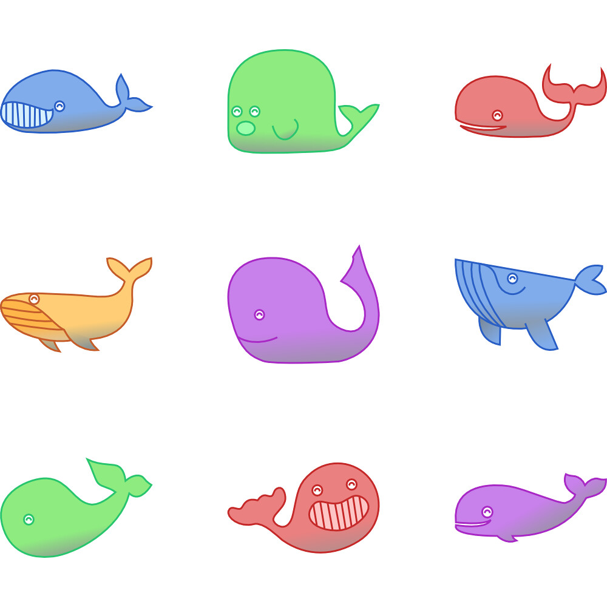

I've recently been collecting examples of whale art. My interest mostly lies around their monotonous use in [hipster](http://www.adbusters.org/magazine/79/hipster.html) art; and they're kind've cute. I put up on Flickr a gallery of [whale archetypes](http://flickr.com/photos/bensheldon/sets/72157607143743022/).

Left-to-right and top-to-bottom, the whales are named: [Billy](http://flickr.com/photos/bensheldon/2833199805/in/set-72157607143743022/), [Gus](http://flickr.com/photos/bensheldon/2834038730/in/set-72157607143743022/), [Tina](http://flickr.com/photos/bensheldon/2834038592/in/set-72157607143743022/), [Sal](http://flickr.com/photos/bensheldon/2833199831/in/set-72157607143743022/), [Sanjay](http://flickr.com/photos/bensheldon/2834038776/in/set-72157607143743022/), [Perth](http://flickr.com/photos/bensheldon/2833199879/in/set-72157607143743022/), [Jill](http://flickr.com/photos/bensheldon/2833199761/in/set-72157607143743022/), [Buddy](http://flickr.com/photos/bensheldon/2834038812/in/set-72157607143743022/), and [Ann](http://farm4.static.flickr.com/3175/2833199805_d370afaf8d_s.jpg). Some of them may be familiar to you.
