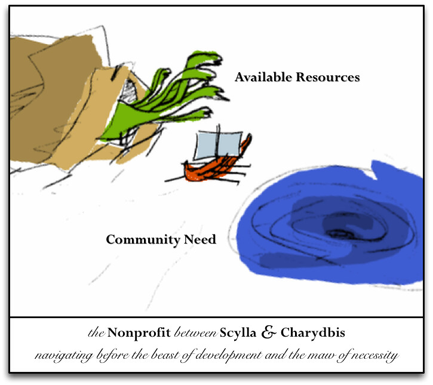

In my [Boston University Institute for Nonprofit Management and Leadership](http://management.bu.edu/exec/elc/inml/index.shtml) program, we always get up to the edge of talking about the interplay between resource development and need, but then it always seems to drift away. So this is my contribution: if you swing too far towards either (ignoring the other), you're toast.

And for the record, available resources and community need are external to your organization. Also, my art is lousy. And if you find this interesting, you should read my previous post on [Community Engagement](http://island94.org/articles/strengthening-organizations-through-community-engagement).
